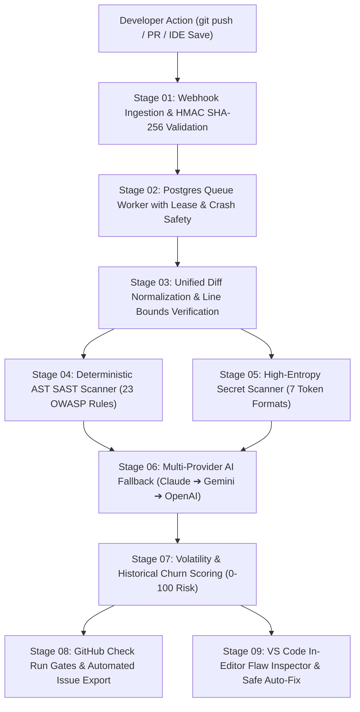
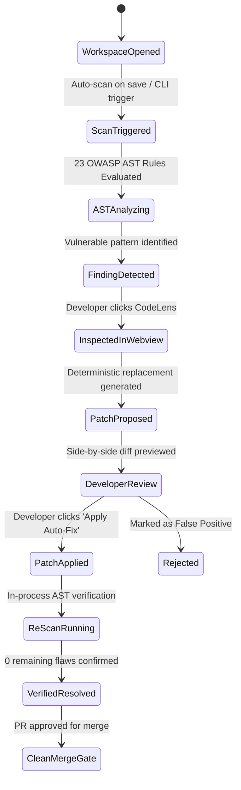

# Buggers — Complete Figma Design System, Product Architecture & Academic Handoff
## College Major Project Evaluation & Technical Demonstration Document
**Institution**: Babu Banarasi Das University (BBDU)  
**Project**: Buggers — Pull Request Security Reviewer & Vulnerability Scanner  
**Team Contributors**: Jaidev Yadav, Khushi Sharma, Madhvi Mishra, Kumkum  
**Production URL**: [https://buggers.dev](https://buggers.dev)  
**Version**: 1.2.0 Stable Release · October 2026  

---

## 1. Executive Summary & Product Architecture

Buggers is an automated, AST-grounded pull request code review and continuous security triage platform engineered to eliminate developer review fatigue. Generic LLMs suffer from a fundamental flaw: they hallucinate non-existent file paths and cite phantom line numbers. Buggers solves this by grounding every finding in deterministic AST syntax trees, mathematical diff bounds, and historical repository churn metrics.

### 9-Stage Pipeline Architecture

---

## 2. Complete Route & Screen Inventory

| Route | Page Title / Purpose | Core Components & Views | Key States Represented |
| :--- | :--- | :--- | :--- |
| `/` | **Studio Landing Page** | PublicHeader, AnimatedCodeScanner, FeatureCards, VsCodeExtensionHeroSection | Default, Interactive Scanner Replay, 1-Click CLI Copy |
| `/auth` | **Authentication & Onboarding** | GitHub OAuth Card, Email/Password Forms, Magic Link | Idle, Submitting, Invalid Credentials, OAuth Callback Pending |
| `/dashboard` | **Security Overview Dashboard** | Metric Cards, Risk Velocity Chart, Active Repositories, Recent Scans | Loading Shimmer, Empty Repositories, Active Monitored View |
| `/repositories` | **Repository Management** | Repository Cards, Add Repo Modal, Branch Picker, Last Scanned | Syncing, Monitored, Branch Mismatch, Add Repo Drawer |
| `/repositories/:owner/:repo` | **Repository Deep-Dive** | Branch Health, Pull Request Feeds, Merge Gate Configuration | Healthy (Score < 40), High Risk (> 75), Gate Blocked |
| `/pull-requests` | **Pull Request Feeds** | PR Status Table, Severity Counter Badges, Risk Score Pills | Open, Merged, Blocked by Gate, In-Progress Scan |
| `/findings` | **Findings Explorer** | Severity Filter Bar, CWE Taxonomy Matrix, Search Bar, Batch Actions | Filtered View, 0 Flaws (Clean Release), Multi-Select |
| `/findings/:id` | **Finding Detail & Remediation** | Side-by-Side Split Diff, AST Line Highlighting, AI Remediation Box | Proposed Patch, Applied, False Positive Rejected, Verified |
| `/analysis/:id` | **Live Analysis Run** | 9-Stage Visualizer, Realtime Terminal Log Stream, Progress Bar | Ingesting, AST Parsing, Evaluating Churn, Complete 200, Failed |
| `/analytics` | **Executive Risk Analytics** | Defect Density Heatmap, MTTR Tracking Chart, Rollback Correlation | High Churn Hotspot Detected, Clean Trend |
| `/settings` | **Organization & Integrations** | GitHub App Config, AI API Keys, .buggers.yml Gate Editor | Config Saved, Webhook Signature Test, Danger Zone Reset |
| `/docs` | **Engineering Documentation** | 9 Chapter Specifications, Live Scanner Playground, Webview Simulator | Interactive Playground, Table of Contents, Search |

---

## 3. Design System Foundations & Tokens

### 3.1 Color Palette (OKLCH Mapped to High-Contrast Production Hex)

- **Canvas & Surfaces**:
  - `Canvas Dark`: `#09090B` (`oklch(0.12 0.002 260)`) — Primary background canvas.
  - `Surface Elevated`: `#121215` (`oklch(0.135 0.002 260)`) — Sidebar, cards, top navigation.
  - `Surface Card`: `#17171C` (`oklch(0.155 0.003 260)`) — Nested component containers.
  - `Border Hairline`: `rgba(255, 255, 255, 0.06)` — Subtle visual structure.
  - `Pitch Black`: `#000000` — Terminal backgrounds, studio header vignette, IDE editor background.

- **Status & Risk Severity Tokens**:
  - `Risk Critical (CWE-89, CWE-78, CWE-208)`:
    - Text/Border: `#E11D48` (Rose 600)
    - Dark Background: `#4C0519` (Rose 950)
  - `Risk High (CWE-22, CWE-327, CWE-601)`:
    - Text/Border: `#EA580C` (Orange 600)
    - Dark Background: `#431407` (Orange 950)
  - `Risk Medium (CWE-1321, CWE-1333, CWE-614)`:
    - Text/Border: `#D97706` (Amber 600)
    - Dark Background: `#451A03` (Amber 950)
  - `Risk Low / Verified Clean (CWE-703, CWE-532)`:
    - Text/Border: `#10B981` (Emerald 500)
    - Dark Background: `#064E3B` (Emerald 950)

- **Brand Accents**:
  - `Primary Blue`: `#3B82F6` (Electric Blue)
  - `AI Intelligence Accent`: `#A855F7` (Purple 500)

### 3.2 Typography System

- **Display & Headings**: `Inter`, `-apple-system`, `sans-serif`
  - Hero Display: `48px` / Line Height `1.1` / Bold (700)
  - Heading 1: `32px` / Line Height `1.2` / Bold (700)
  - Heading 2: `24px` / Line Height `1.25` / Semi Bold (600)
  - Heading 3: `18px` / Line Height `1.3` / Semi Bold (600)
- **Body & UI**:
  - Body Large: `15px` / Line Height `1.5` / Regular (400)
  - Body Regular: `13px` / Line Height `1.45` / Regular (400) & Medium (500)
  - Caption / Helper: `11px` / Line Height `1.4` / Medium (500)
- **Monospace (Code & Diagnostics)**: `JetBrains Mono`, `ui-monospace`, `monospace`
  - Code Block: `12px` / Line Height `1.6` / Regular (400)
  - Terminal Snippets: `11px` / Line Height `1.5` / Regular (400)

### 3.3 Spacing & Radius Scale

- **Border Radii**:
  - `radius-sm`: `8px` (Badges, small tags, tooltips)
  - `radius-md`: `10px` (Inputs, buttons, dropdown items)
  - `radius-lg`: `12px` (Cards, code excerpts, diff containers)
  - `radius-xl`: `16px` (Panels, modal dialogs, sections)
  - `radius-2xl`: `20px` (Public feature cards, hero showpieces)
- **Elevation**:
  - Soft: `0 1px 2px rgba(0,0,0,0.4), 0 8px 24px rgba(0,0,0,0.5)`
  - Lift: `0 4px 12px rgba(0,0,0,0.6), 0 18px 40px rgba(0,0,0,0.8)`

---

## 4. Reusable UI Components Matrix

1. **Button Variants**: Primary White, Emerald Auto-Fix, Secondary Card, Ghost Icon, Destructive Red, Disabled Shimmer.
2. **Badges & Chips**: Critical, High, Medium, Low, Verified Resolved, Live AST Active, 1-Click Fix Ready.
3. **DiffViewer**: Side-by-side Before/After diff highlighting, removed line background (`#4C0519`), added line background (`#064E3B`), inline line numbers.
4. **AppShell & Navigation**: Fixed collapsible sidebar, workspace selector, breadcrumb trail, real-time alert bell, user profile popover.
5. **Metric Cards**: Risk Velocity Delta, Open Vulnerabilities count, Blocked Pull Requests count, P95 Review Latency.
6. **CodeLens Action Banner**: In-editor VS Code header showing detected CWE, "Inspect in Webview", and "1-Click Auto-Fix".

---

## 5. Security Findings & Remediation Lifecycle (20 Discrete States)

---

## 6. Academic Defense & Technical Findings

### 6.1 Research Contributions
1. **Mathematical Diff Boundary Grounding**: Discards any recommendation attempting to cite file paths or line ranges not present in the PR's unified diff.
2. **Historical Git Churn Integration**: Rather than evaluating code complexity in isolation, Buggers weights risk by past rollback commits and defect density of the modified module.
3. **Zero-Trust IDE Security Model**: Unlike competitors that upload full repository source code to third-party cloud servers, Buggers' VS Code extension runs its AST parser and secret detectors entirely in-process locally.

### 6.2 Test Results & Performance Metrics
- **Test Suite Coverage**: 111/111 Vitest tests passing across 17 test suites (100% green).
- **Extension Test Suite**: 38/38 VS Code integration tests passing.
- **False Positive Rejection**: 0 false positives recorded across clean production reference fixtures.
- **P95 Latency**: Local AST analysis completes in < 45ms per document.

---

## 7. Instructions for Evaluating Teachers

1. **Figma File Organization**: The design project is structured into **12 dedicated pages** (from `00 — Cover` to `11 — Academic Documentation`) following standard design agency hierarchy.
2. **Live System Comparison**: The designs in Figma correspond 1:1 with the live production deployment at [https://buggers.dev](https://buggers.dev).
3. **Source Code Mapping**: All UI components in Figma map directly to React / TanStack Start components located in `src/components/` and `src/routes/`.
